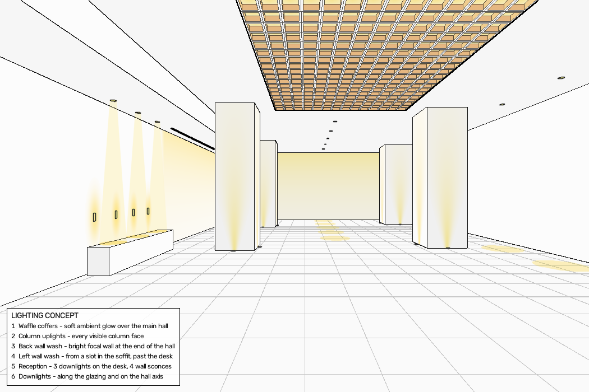
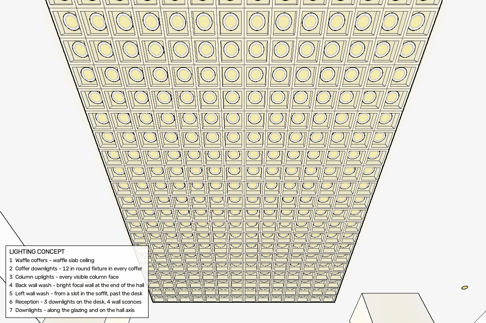
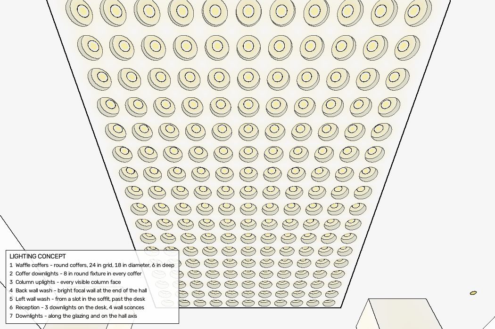
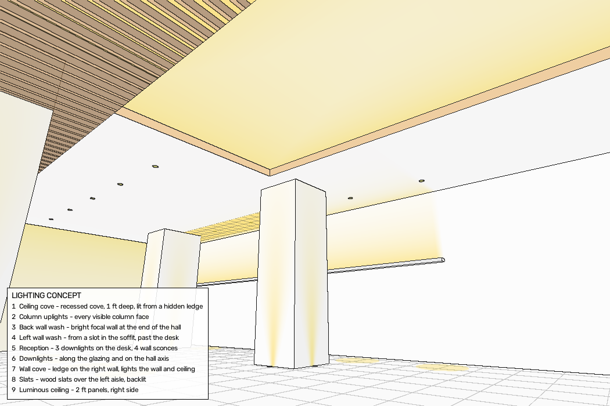

# glowpoint

Put lighting concepts on an architect's perspective drawing, placed accurately in 3D.

You start with a perspective image of a space: a render from 3D software or a hand sketch, in one-, two- or three-point perspective. glowpoint builds a simple 3D model behind the drawing (the camera, the floor, the walls, the ceiling, the columns). Then you describe the lighting in a design file, for example "three downlights equally spaced above the desk" or "an uplight on every visible column face". glowpoint calculates the exact positions and draws the light on the original drawing, in the correct perspective.

The output is diagrammatic, not photorealistic. It shows **what is lit and where the light comes from**, for a design review with the architect.



*The lobby example from `projects/lobby`, drawn as linework from its model. With the architect's drawing in the project folder, the same lights are drawn on the drawing.*

---

## Contents

- [Install](#install)
- [Quick start](#quick-start)
- [Sandboxes without internet (ChatGPT and others)](#sandboxes-without-internet-chatgpt-and-others)
- [How it works](#how-it-works)
- [Project folder](#project-folder)
- [model.json: the 3D model](#modeljson-the-3d-model)
- [design.json: the lighting design](#designjson-the-lighting-design)
- [Light and ceiling types](#light-and-ceiling-types)
- [Relationships (expressions)](#relationships-expressions)
- [Outputs](#outputs)
- [Setting up a new drawing](#setting-up-a-new-drawing)
- [Adding your own types (plugins)](#adding-your-own-types-plugins)
- [Working without merge conflicts](#working-without-merge-conflicts)
- [Notes for AI agents](#notes-for-ai-agents)
- [Limits](#limits)
- [Roadmap](#roadmap)

---

## Install

Python 3.10 or newer.

```bash
git clone https://github.com/danomoseley/glowpoint.git
cd glowpoint
pip install -r requirements.txt
```

The only dependencies are `numpy` and `opencv-python`. It runs on Linux, macOS, and Windows.

## Quick start

The lobby example runs without its drawing (the drawing is not in this repository). `--linework` draws the model itself:

```bash
python3 -m glowpoint.render projects/lobby --linework
```

With your own drawing in the project folder, draw the lights on the drawing, and make the check image too:

```bash
python3 -m glowpoint.render projects/lobby --check
```

This writes:

| File | What it is |
|---|---|
| `projects/lobby/out/concept.png` | The drawing (or linework) with the lighting and a legend |
| `projects/lobby/out/check.png` | The 3D model on the drawing, with a 4 ft grid on each surface |
| `projects/lobby/out/positions.csv` | Every light: layer, type, surface, X/Y/Z in feet |

To change the lighting, edit `design.json` and run the same command again.

| Option | Use |
|---|---|
| `--check` | Also write `out/check.png` |
| `--linework` | Draw the model as linework instead of using the drawing |
| `--camera view.json` | Render from another camera (see below). The path is from the current folder |
| `--design file.json` | Use another design file, for example an option B |
| `--out name.png` | Name of the output image in `out/`. With any name other than `concept.png`, the other outputs get the same name: `check_name.png`, `positions_name.csv` |

A project without `design.json` renders the model with no lights. Use this to check a new model before you design.

To see the same design from another position, give a camera. The model is drawn as linework, because the architect's image only fits its own camera. This camera stands in the lobby's left doorway, at eye height, and looks toward the far end of the hall:

```bash
python3 -m glowpoint.render projects/lobby --camera door.json --out door.png
```

```json
{"f": 626, "principal": [525, 350], "position": [-24.4, 5.5, 31.0], "yaw": 20, "pitch": 0, "roll": 0}
```

`position` is in model feet. `yaw` 0 looks along +Z (into the original drawing), 90 looks along +X (to the right). `f` is the lens in pixels: for an image 1050 px wide, 626 px is an 80° field of view.

## Sandboxes without internet (ChatGPT and others)

Some chat assistants run code in a sandbox that cannot reach GitHub or install packages. Use glowpoint there like this:

1. On GitHub, click **Code → Download ZIP**, and upload `glowpoint-main.zip` to the chat.
2. Ask the assistant to unzip it and run `python3 -m glowpoint.doctor` from the `glowpoint-main` folder. It prints the Python, numpy, and OpenCV versions and `READY` or `NOT READY`. glowpoint needs only numpy and OpenCV, which most sandboxes already have.
3. Then ask it to follow `AGENTS.md`.

If the sandbox can run Python but not shell commands, use the functions directly:

```python
import sys; sys.path.insert(0, "glowpoint-main")
from glowpoint.render import render
render("glowpoint-main/projects/lobby", linework=True)          # same as: python3 -m glowpoint.render ... --linework

from glowpoint import calibrate, measure, zoom                  # each tool has a main(); for example:
measure.main(["glowpoint-main/projects/lobby", "floor", "302", "444"])
```

If OpenCV has no LSD line detector (some versions), the camera setup uses a Hough line detector instead. It is a little less accurate (lens within about 1 % on the test images, instead of 0.3 %). `glowpoint.doctor` tells you which one you have.

## How it works

1. **Camera.** The setup tool finds the camera from the vanishing points in the image: the lens, the turn, the tilt, and the roll. One known dimension sets the scale.
2. **Model.** The space is a set of flat rectangles (floor, walls, ceiling, soffits) and boxes (columns, desks). All sizes are in feet.
3. **Ray casting.** For each pixel of the drawing, glowpoint finds which surface the pixel shows and the 3D point on it. This gives exact perspective and correct hiding: a light behind a column does not show.
4. **Design.** Each light is placed on a named surface. Its position is a relationship to the model ("centered between Column L1 and Column R1"), not a fixed number. When the model changes, the lights follow.
5. **Drawing.** Light is drawn as a soft warm glow over the original linework, so the architect's drawing stays readable.

Coordinates: **X** to the right, **Y** up (floor = 0), **Z** into the image, in feet. The drawing's camera usually stands at X = 0, Z = 0.

## Project folder

```
projects/lobby/
  drawing.png    the architect's perspective drawing (PNG or JPG)
  model.json     the 3D model behind the drawing
  design.json    the lighting design
  out/           output images and positions.csv (made by the render command)
```

One folder for each drawing. To start a new project, make a new folder with the drawing, then follow [Setting up a new drawing](#setting-up-a-new-drawing). Keep your projects outside this repository or in `local/` (see [Working without merge conflicts](#working-without-merge-conflicts)).

To experiment with the lobby example, copy it first: `cp -r projects/lobby local/lobby`. The tests use their own copy in `tests/fixtures/`, so the example can change without breaking them, but a copy keeps the repository clean.

> **Use the original drawing.** glowpoint marks every PNG that it writes (a hidden text field, the pixels do not change) and refuses a marked image as `drawing.png`, so an output with lights already drawn on it is not used again by mistake. Screenshots and JPEG copies lose the mark, so keep the original file.

> **Drawings are not in this repository.** The architects' drawings belong to the architects or their clients. `.gitignore` excludes `projects/*/drawing.*` and `projects/*/out/`. The lobby example runs with `--linework`.

## model.json: the 3D model

```json
{
  "drawing": "drawing.png",
  "units": "ft",
  "camera": {"vp": [543, 345], "f": 550, "eye_height": 9.388},
  "calibration": "One-point perspective. Scale from people at 5 ft 8 in.",
  "surfaces": [
    {"name": "Floor",     "axis": "Y", "at": 0,     "X": [-25.37, 38.57], "Z": [5.07, 111.64]},
    {"name": "Left wall", "axis": "X", "at": -25.37, "Y": [0, 20.81],    "Z": [5.07, 111.64]}
  ],
  "boxes": [
    {"name": "Column L1", "kind": "column", "X": [-14.82, -8.32], "Y": [0, 24.36], "Z": [50.65, 57.14]},
    {"name": "Desk",      "kind": "object", "X": [-24.8, -22.3],  "Y": [0, 3.26],  "Z": [35.13, 52.16]}
  ]
}
```

The camera has two forms.

**General** (two- and three-point images; what `glowpoint.calibrate` writes):

```json
"camera": {"f": 651.3, "principal": [526.8, 350.3], "position": [0, 5.5, 0], "yaw": 25.1, "pitch": 12.0, "roll": 0.0}
```

**One-point** (the camera looks straight along +Z):

```json
"camera": {"vp": [543, 345], "f": 550, "eye_height": 9.388}
```

| Field | Meaning |
|---|---|
| `camera.f` | Lens, in pixels (distance from the eye to the picture plane) |
| `camera.principal` | The point in the image straight in front of the camera, in pixels (usually the image centre) |
| `camera.position` | Eye position in feet. Usually `[0, eye height, 0]` |
| `camera.yaw`, `pitch`, `roll` | Turn to the right, tilt up, and roll, in degrees |
| `camera.vp` | One-point form: the vanishing point in pixels |
| `camera.eye_height` | One-point form: height of the eye above the floor, in feet |
| `surfaces[].axis` | The axis the surface is perpendicular to. `Y` = floor, ceiling, soffit. `X` = left or right wall. `Z` = back wall |
| `surfaces[].at` | Position of the surface on that axis |
| `surfaces[].X/Y/Z` | Size of the surface on the other two axes |
| `boxes[]` | Columns and objects. `kind` is `column` or `object` |

Each box makes five surfaces, named `"<name> front"`, `"back"`, `"left"`, `"right"`, and `"top"`. Front is the side at the low Z end (toward the drawing's camera), left is the low X side. On the drawing, objects (like the desk) are not drawn, because the drawing already shows them. In linework, check images, and other camera views they are drawn as boxes. They always hide light that is behind them, and lights can refer to them.

Surfaces and boxes can have a `"note"` field. Use it to record how a value was found or what was assumed, for example a hidden end of an object.

## design.json: the lighting design

A design is a list of **layers**. Each layer has a name, a short description (for the legend), and **features** (lights or ceiling elements).

```json
{
  "title": "LIGHTING CONCEPT",
  "layers": [
    {
      "name": "Reception",
      "description": "3 downlights on the desk, 4 wall sconces",
      "features": [
        {"type": "downlight", "plane": "Left soffit",
         "x": "box('Desk').xc",
         "z": "spaced(box('Desk').z0, box('Desk').z1, 3)",
         "d": "inch(8)", "beam_to": "box('Desk').top", "pool_r": 1.4},
        {"type": "sconce", "plane": "Left wall",
         "along": "spaced(box('Desk').z0, box('Desk').z1, 4)", "y": 6.5}
      ]
    }
  ]
}
```

Any value can be a number or a text expression (see [Relationships](#relationships-expressions)). If a position is a list, glowpoint makes one light for each value. If two positions are lists, it makes one light for each combination (a grid).

Set `"legend": false` at the top level to leave out the legend.

glowpoint warns when two fixtures from different layers are at the same place (for example a pendant and a downlight above the same point).

## Light and ceiling types

| Type | What it is |
|---|---|
| [`downlight`](#downlight) | Round downlight symbol in a ceiling, with a beam and a pool |
| [`sconce`](#sconce) | Wall light with a wash up and down |
| [`uplight`](#uplight) | In-floor uplight that grazes a column face or wall |
| [`wash`](#wash) | Wall wash from the top of a wall, optionally from a ceiling slot |
| [`pendant`](#pendant) | Pendant on a cord, from a ceiling or from inside coffers |
| [`fixture`](#fixture) | A specific fixture, drawn from its parts (trim, lens, rings, slots) |
| [`luminous`](#luminous) | A glowing ceiling or wall area (luminous ceiling, backlit stretch ceiling), with optional panel joints |
| [`waffle`](#waffle) | Square or round coffers cut into a ceiling |
| [`cove`](#cove) | A recessed ceiling cove (tray), or a wall cove (a lit ledge on a wall) |
| [`slats`](#slats) | Parallel slats or baffles below a ceiling, optionally lit from above |

More types can be added as plugins (see [Adding your own types](#adding-your-own-types-plugins)).

Positions on a surface:

| Surface | Position keys |
|---|---|
| Horizontal (floor, ceiling, soffit, box top) | `x`, `z` |
| Wall at constant X (left wall, right wall, box left/right) | `along` (= Z), `y` |
| Wall at constant Z (back wall, box front/back) | `along` (= X), `y` |

### `downlight`
A round downlight in a horizontal surface.

| Key | Default | Meaning |
|---|---|---|
| `plane` | | Surface name |
| `x`, `z` | | Position(s) |
| `d` | 8 in | Aperture diameter, ft |
| `beam_to` | 0 | Height where the beam lands (0 = floor; use `box('Desk').top` for a desk) |
| `pool_r` | 1.5 | Radius of the light pool, ft |
| `cone` | true | Draw the beam |
| `pool_a` | 0.5 | Strength of the pool, 0 to 1 |

### `sconce`
A wall light with a soft wash up and down.

| Key | Default | Meaning |
|---|---|---|
| `plane` | | Wall name |
| `along`, `y` | | Position(s) along the wall and height to the center |
| `w`, `h` | 0.4, 1.0 | Size of the fixture, ft |
| `spread`, `reach` | 0.9, 2.6 | Width and height of the wash, ft |

### `uplight`
An in-floor uplight that grazes a vertical face. Usually for columns.

| Key | Default | Meaning |
|---|---|---|
| `faces` | | One face name, a list, or `visible_faces('column')` |
| `at` | center | Position across the face |
| `offset` | 0.5 | Distance from the face, ft |
| `fade` | 12 | Height over which the wash fades, ft |

### `wash`
A wall wash from the top of a wall, optionally from a slot in the ceiling.

| Key | Default | Meaning |
|---|---|---|
| `plane` | | Wall name |
| `range` | | (start, end) along the wall |
| `y_top` | top of the wall | Height where the wash starts |
| `fade`, `strength` | 10, 0.8 | How fast the wash fades down, and how bright it is |
| `slot` | none | `{"plane": "Left soffit", "offset": 2}` draws the slot in that ceiling, `offset` ft from the wall |

### `pendant`
A pendant hanging from a horizontal surface, with a glow around the shade and an optional pool.

| Key | Default | Meaning |
|---|---|---|
| `plane` | | Surface it hangs from |
| `from_y` | | Instead of `plane`: the height where the cord starts. For pendants in coffers: `"coffers('Waffle', 'y')"` |
| `x`, `z` | | Position(s) |
| `y` | | Height of the bottom of the shade above the floor, ft. Use this for "3 ft above the desk": `"box('Desk').top + 3"` |
| `drop` | 10 | Distance from the cord start (the `plane` or `from_y`) to the bottom of the shade, ft. This sets the pendant length |
| `d`, `h` | 1.5, 0.6 | Shade diameter and height, ft |
| `pool_r` | 0 | Radius of a light pool, ft (0 = none) |
| `beam_to` | 0 | Height of the pool (0 = floor) |

Give the length with `drop` or the height with `y`. If both are given, `y` is used. For pendants of different lengths, use one feature for each length.

### `fixture`
A specific fixture, drawn from its parts (trim, lens, rings, slots), flush on a surface. Use it to show the real fixture of the design, not a generic symbol. The fixture is defined one time in a **fixture list** and used in many places.

```json
{"type": "fixture", "fixture": "round-12in-downlight",
 "x": "coffers('Waffle', 'x')", "z": "coffers('Waffle', 'z')", "y": "coffers('Waffle', 'y')"}
```

| Key | Meaning |
|---|---|
| `fixture` | Name in the fixture list |
| `plane` | Surface the fixture is on (or give `y` for a horizontal level, for example the top of the coffers) |
| `x`, `z` or `along`, `y` | Position(s), as for the other types |
| `rotate` | Turn the fixture on its surface, degrees |

**Fixture list.** Put it in `<project>/fixtures.json`, or in a `"fixtures"` block in `design.json` (that one wins). [`examples/fixtures.json`](examples/fixtures.json) has a round downlight, a 2×2 troffer, and a linear slot.

```json
"round-12in-downlight": {
  "parts": [
    {"kind": "fill", "shape": "round", "d": 1.0, "color": "trim"},
    {"kind": "line", "shape": "round", "d": 1.0, "width": 0.03},
    {"kind": "fill", "shape": "round", "d": 0.7, "color": "lit"}
  ],
  "glow": {"r": 0.9, "strength": 0.55}
}
```

Parts are drawn in order, so later parts are on top. All sizes in feet.

| Part key | Meaning |
|---|---|
| `kind` | `fill` (a filled shape), `line` (the outline of a shape), `slots` (parallel lines inside a shape: louvers, blades) |
| `shape` | `round` (`d`), `square` (`w`), or `rect` (`w` across, `l` along) |
| `width` | Line width, ft. Thin lines stay at least about one pixel wide |
| `n`, `angle` | `slots`: number of lines, and their direction in degrees |
| `color` | `lit`, `trim`, `metal`, `dark`, `black`, `white`, or `[R, G, B]` |
| `glow` | For the fixture: `r` (ft) and `strength` (0 to 1) of the light around it |



To describe a fixture from a photo or a spec sheet: start with the outer trim (`fill` + `line`), then the lens or aperture (`fill`, `lit`), then details (`line` rings, `slots`). Use the real dimensions from the spec sheet.

### `luminous`
A glowing area on a surface: a luminous ceiling, a backlit stretch ceiling, or a light wall.

```json
{"type": "luminous", "plane": "Ceiling", "X": "(box('Column R1').x1 + 1, surf('Right wall').at - 1)", "Z": [62, 100], "grid": 2.0}
```

| Key | Default | Meaning |
|---|---|---|
| `plane` | | Surface |
| `X`, `Y`, `Z` | | (start, end) of the area on the two axes of the surface: `X` and `Z` on a ceiling, `Z` and `Y` on a wall at constant X, `X` and `Y` on a wall at constant Z |
| `strength` | 0.9 | Brightness, 0 to 1 |
| `soft` | 0.5 | Width of the softer border, ft |
| `grid` | none | Panel size, ft: draws the joints between panels |
| `joint` | 0.03 | Joint width, ft |

### `waffle`
A waffle-slab ceiling of square coffers. It changes the model, so lights hide correctly inside the coffers.

| Key | Default | Meaning |
|---|---|---|
| `plane` | | The ceiling it is cut into |
| `X`, `Z` | | (start, end) of the waffle area |
| `shape` | `square` | `square` (coffers separated by ribs) or `round` (round recesses in a flat ceiling) |
| `module` | | Grid spacing, centre to centre, ft |
| `rib` | | Square coffers: rib width, ft (the coffer opening is `module − rib`) |
| `d` | | Round coffers: diameter, ft. Must be smaller than `module` |
| `depth` | | Coffer depth, ft |
| `align` | `start` | `start`: the grid starts at the far end (`Z` end) and the left edge (`X` start); a cut coffer can remain at the other edges. `centre`: only full coffers, centred in the area, with equal solid borders |
| `lit` | true | true: coffers glow. false: coffers are plain (use this when fixtures in the coffers give the light) |

Pendants in coffers: a pendant in every second coffer across and every third in depth, hanging from the coffer tops (Python slices select from the lists):

```json
{"type": "pendant", "from_y": "coffers('Waffle', 'y')", "x": "coffers('Waffle', 'x')[1::2]",
 "z": "coffers('Waffle', 'z')[::3]", "y": 14, "d": 1.2}
```

Round coffers, 24 in on centre, 18 in diameter, 6 in deep, centred:

```json
{"type": "waffle", "plane": "Ceiling", "X": "inset(gap('Column L1', 'Column R1'), 3)",
 "Z": "(surf('Ceiling').Z[0], centre_line('Column L1', 'Column R1', 'Z'))",
 "shape": "round", "module": "inch(24)", "d": "inch(18)", "depth": "inch(6)", "align": "centre", "lit": false}
```



### `cove`
Two kinds of cove. Both change the model, so the cove hides what is behind it.

**Recessed cove** (`"kind": "recess"`): a tray recessed into the ceiling. The light comes from a hidden ledge at its edges, so the top of the tray is brightest near the edges.

```json
{"type": "cove", "kind": "recess", "plane": "Ceiling", "X": "inset(gap('Column L1', 'Column R1'), 3)",
 "Z": "(surf('Ceiling').Z[0], centre_line('Column L1', 'Column R1', 'Z'))", "depth": 1.0}
```

**Wall cove** (`"kind": "wall"`): a ledge along a wall with a hidden light on top. It lights the wall above it and, if you name the ceiling, the ceiling near the wall.

```json
{"type": "cove", "kind": "wall", "name": "Right cove", "plane": "Right wall", "range": [40, 105],
 "y": 14, "depth": 1.0, "ceiling": "Ceiling"}
```

| Key | Default | Meaning |
|---|---|---|
| `kind` | `recess` | `recess` or `wall` |
| `name` | `Cove` | Name of the cove. Give each cove a different name |
| `plane` | `Ceiling` | Recess: the ceiling it is cut into. Wall: the wall |
| `X`, `Z` | | Recess: (start, end) of the tray |
| `depth` | 1.0 (wall) | Recess: depth of the tray, ft. Wall: how far the ledge projects from the wall, ft |
| `range` | | Wall: (start, end) along the wall |
| `y` | | Wall: height of the top of the ledge, ft |
| `h` | 0.5 | Wall: height of the ledge fascia, ft |
| `fade` | 4.0 | Wall: how far up the wall the light goes, ft |
| `ceiling` | none | Wall: name of the ceiling that gets light near the wall |
| `spread` | 4.0 | Wall: how far onto the ceiling the light goes, ft |
| `strength` | 0.85 | Brightness, 0 to 1 |

### `slats`
Parallel slats (or baffles) hanging below a ceiling, ray-traced so that you see between them in perspective. Lights and surfaces behind the slats show through the gaps and are hidden by the slats.

```json
{"type": "slats", "X": "(surf('Soffit step').at, -5.32)", "Z": "(surf('Ceiling').Z[0], surf('Back wall').at)",
 "y": 20, "h": "inch(6)", "w": "inch(3)", "pitch": 1.0, "direction": "x", "color": "wood", "backlit": true}
```

| Key | Default | Meaning |
|---|---|---|
| `name` | `Slats` | Name. Give each slat field a different name |
| `X`, `Z` | | (start, end) of the slat area |
| `y` | | Height of the bottom of the slats, ft |
| `h`, `w` | | Height and width of each slat, ft |
| `pitch` | | Spacing, centre to centre, ft |
| `direction` | `z` | The direction the slats run: `z` (away from the viewer) or `x` (across) |
| `color` | `wood` | `wood`, `white`, `dark`, or `[R, G, B]` |
| `backlit` | false | true: light between the slats (a lit ceiling above them) |



## Relationships (expressions)

Expressions refer to the model by name. Use them for all positions that depend on the architecture, so lights move when the model is corrected.

| Expression | Result |
|---|---|
| `box('Desk').x0`, `.x1`, `.xc`, `.z0`, `.z1`, `.zc`, `.y0`, `.top` | Edges and centre of a box |
| `surf('Left soffit').at`, `.X`, `.Y`, `.Z` | Position and ranges of a surface |
| `gap('Column L1', 'Column R1')` | (lo, hi) between the inner faces of two boxes, on X |
| `gap('Column L1', 'Column L2', 'Z')` | The same, on Z |
| `centre_line('Column L1', 'Column R1', 'Z')` | Average of the two box centres on an axis |
| `inset((lo, hi), d)` | (lo + d, hi − d) |
| `mid((lo, hi))` | Centre of a range |
| `spaced(lo, hi, n)` | n positions, equal spaces, half a space at each end |
| `spaced_ends(lo, hi, n)` | n positions, the first at lo and the last at hi |
| `every(start, stop, step)` | start, start + step, … up to stop |
| `list[a:b:c]` | Part of a list, as in Python: `coffers('Waffle', 'x')[1::2]` is every second item, starting with the second |
| `inch(n)` | n inches in feet |
| `visible_faces('column')` | Every face of every column that is visible in the drawing |
| `coffers('Waffle', 'x')`, `coffers('Waffle', 'z')` | Centres of all full coffers of a waffle (square or round, with its `align`), across and in depth. Use both for one item in every coffer |
| `coffers('Waffle', 'y')` | Height of the coffer tops (ceiling + depth), for fixtures inside the coffers |

Examples:

```text
"X": "inset(gap('Column L1', 'Column R1'), 3)"          waffle 3 ft from the inner column faces
"x": "mid((box('Column R1').x1, surf('Right wall').at))" halfway between a column and the wall
"z": "every(centre_line('Column L1', 'Column R1', 'Z') + 9, surf('Back wall').at - 6, 10)"
```

Expressions run in a restricted Python evaluator with only these names (and Python arithmetic, lists, and slices).

**Text that is not an expression.** These keys always hold plain text and are never evaluated: `layer`, `type`, `name`, `note`, `plane`, `slot`, `fixture`, `shape`, `align`, `kind`, `direction`, `color`, `ceiling`. Every other text value is an expression, so a new text option in a plugin must be added to that list in `glowpoint/render.py`, or a word such as `round` is read as a Python name.

## Outputs

- **concept.png** — the drawing with the lighting and a legend made from the layer names and descriptions.
- **check.png** (with `--check`) — every surface tinted and named, with a 4 ft grid. If the grid follows the lines of the drawing, the model is correct.
- **positions.csv** — one row for each light: layer, type, surface, X/Y/Z (ft), and `visible`. Use it to check the design and to give positions to others. `visible` is about the fixture point itself: an uplight hidden behind a bench is `False`, although the column face that it lights can be in view.

`visible_faces()` always means visible in the drawing's own camera, also when you render another view. Thus a design is the same in all views.

## Setting up a new drawing

### 1. Find the camera

```bash
python3 -m glowpoint.calibrate projects/new/drawing.png --known 640,520,640,388,10
```

The tool finds the straight lines, groups them by vanishing point, and calculates the camera. `--known x1,y1,x2,y2,H` gives the scale: pixel (x1, y1) is on the floor, pixel (x2, y2) is on the same vertical edge, and they are H feet apart (a door frame, a column edge from floor to ceiling, a person). In a three-point image vertical edges lean; follow the edge. Or give `--eye-height`.

It prints a report and writes `camera.json` (paste it into `model.json` as `"camera"`) and `calibration.png` (each group of lines in one color):

```
282 line segments, 3 vanishing points, three-point perspective
  VP1: 146 lines, fit 0.26 deg rms, at (1947, 488) px, horizontal
  VP2: 82 lines, fit 0.39 deg rms, at (215, 489) px, horizontal
  VP3: 23 lines, fit 0.12 deg rms, at (526, -2708) px, vertical
  lens f = 651.3 px  (horizontal field of view 77.7 deg)
  turn (yaw) 25.13 deg, tilt (pitch) 12.02 deg, roll 0.02 deg
  angles between the found directions (90 = perfect): 90.00, 90.00, 90.00
```

Options:

| Option | Use |
|---|---|
| `--known x1,y1,x2,y2,H` | Scale from one known vertical |
| `--eye-height FT` | Scale from a known eye height |
| `--f PX` | Lens in pixels, if known (necessary for one-point images) |
| `--tol DEG` | How far a line can be from its vanishing point (default 1; hand drawings 2) |
| `--out FILE` | Camera file to write (default `camera.json`) |
| `--overlay FILE` | Line-group image to write (default `calibration.png`) |

How to read it:

- **fit** — how well the lines meet at each vanishing point. Renders: below 0.5°. Hand drawings: 1° to 3° (use `--tol 2`).
- **angles between the found directions** — the room's main directions must be 90° apart. More than 1° from 90 means a wrong line group or a non-square room. Look at `calibration.png`.
- **one-point** images: the lens cannot be found from lines alone. Give `--f`, or calculate it from something square (see below).

The world frame: the origin is on the floor below the camera, Y is up, Z is the room direction most in front of the camera, and X is to its right.

### 2. Start model.json

Make `model.json` in the project folder with the camera from step 1:

```json
{
  "drawing": "drawing.png",
  "units": "ft",
  "camera": {"f": 651.3, "principal": [526.8, 350.3], "position": [0, 5.5, 0], "yaw": 25.1, "pitch": 12.0, "roll": 0.0},
  "calibration": "Scale from the door frame at 7 ft.",
  "surfaces": [],
  "boxes": []
}
```

### 3. Build the surfaces

To find exact pixel positions, use the zoom tool. It makes an enlarged image with the original pixel coordinates on a grid, and writes it to `out/zoom.png` next to the image (or `--out`):

```bash
python3 -m glowpoint.zoom projects/new/drawing.png                       # whole image, coarse grid
python3 -m glowpoint.zoom projects/new/drawing.png 150 390 330 500       # zoom on a box (X0 Y0 X1 Y1)
python3 -m glowpoint.zoom projects/new/drawing.png 150 390 330 500 --mark 302,444   # confirm a point
python3 -m glowpoint.zoom projects/new/drawing.png 650 160 860 460 --model projects/new  # model edges in red
```

Pixels: a whole number is the centre of a pixel, and the grid lines go through pixel centres. Fractions such as 302.5 are allowed in all tools. Far from the camera one pixel can be more than half a foot, so use fractions there.

Then measure the room in feet with the measure tool, then add the surfaces and boxes to `model.json`. The tool reads the camera from `model.json` (or give it `camera.json` instead of the project folder):

```bash
python3 -m glowpoint.measure projects/new floor 302 444          # floor point:  X -22.85  Z 52.16
python3 -m glowpoint.measure projects/new height 203 492 203 441 # height above a floor point: 3.26 ft
python3 -m glowpoint.measure projects/new plane 760 182 Y 24.36  # point on the plane Y = 24.36 (a ceiling)
python3 -m glowpoint.measure projects/new plane 120 300 X -25.37 # point on the wall X = -25.37
python3 -m glowpoint.measure projects/new project -22.85 0 52.16 # the pixel of a 3D point: check a corner
```

`height` measures along the true vertical, also when vertical edges lean in a three-point image.

Typical steps:

1. **Floor:** `floor` on the far corners that you can see. Make the floor surface a little larger than the room.
2. **Walls:** `floor` on two points of each wall's base line. A wall along Z has the same X at both points; that X is its `at`.
3. **Ceiling:** `height` from a floor point to the ceiling line straight above it.
4. **Columns and objects:** `floor` on the base corners, `height` for the top. Add each one as a box.

Name surfaces and boxes clearly (`Left wall`, `Column L1`, `Desk`). The design refers to these names.

**Hidden parts.** When part of an object is hidden (for example one end of a bench behind a column), find its limits from what you can see: the hidden end must be behind the edge that hides it (use `plane` at that edge). Then choose a value inside the limits, usually by symmetry, and write the assumption in the box's `note`. Do not model objects that are fully hidden.

### 4. Check

Run `python3 -m glowpoint.render projects/new --check` and look at `out/check.png`. Each surface must follow the lines of the image. For a close check, zoom with `--model projects/new`: every red model edge must lie on a line of the image. Use `measure ... project X Y Z` to compare corners in numbers. If a surface is off, measure it again.

### One-point images and hand drawings

For a one-point image, set the lens from something square in plan, for example a column: if its front corner is at pixel x1 and its back corner (same side) at x2, and the front face is w pixels wide, then `f = w / ((x1 − vp_x)/(x2 − vp_x) − 1)`. Average several measurements on a hand drawing.

Hand drawings are not exact. Match the model to the drawing, not to an ideal grid.

### Tests

`python3 tests/test_docs.py` checks that this README and AGENTS.md describe the code: every type and each option that it reads, every expression, every tool, every plain-text key, and every link.

To contribute: run `git config core.hooksPath .githooks` once in your clone. Then every `git push` first runs the documentation test and all tests, and stops if one fails. Update README.md and AGENTS.md in the same commit as the code change.

`python3 tests/test_render.py` draws the lobby test fixture (`tests/fixtures/lobby`) and checks it three ways: the light positions (within 0.01 ft), the surface that each pixel shows (exact, the same on every OpenCV version), and the image (loosely, because OpenCV versions draw text and soft edges a little differently). `--update` accepts an intended change.

`python3 tests/test_calibrate.py` renders the lobby model from known cameras (two- and three-point, with tilt and roll), runs the setup on each image, and compares the result with the true camera. Current results: lens within 0.3 %, angles within 0.15°, scale within 1 %.

## Adding your own types (plugins)

You can add light types, ceiling types, and expression helpers **without changing glowpoint's files**. A plugin is one Python file. glowpoint loads plugins from:

1. Each folder in the `GLOWPOINT_TYPES` environment variable (separate several folders with `:` on Linux and macOS, `;` on Windows). Use this for types that a whole office shares, for example a folder on a shared drive.
2. `<project>/types/`. Use this for a type that only one project needs.

A later file can replace a type with the same name, so a project can change an office type for itself. glowpoint prints each plugin that it loads. Files that start with `_` are skipped.

A plugin can define any of these:

```python
LIGHTS = {"linear_strip": linear_strip}  # function(canvas, feature)
GEOMETRY = {"vault": (prepare, draw)}    # prepare(model, feature) before ray casting,
                                         # draw(canvas, feature, base_image) -> new base image
def helpers(model):                      # extra names for design.json expressions
    return {"between": lambda a, b: ...}
```

[`examples/types/linear_strip.py`](examples/types/linear_strip.py) is a complete example: a linear LED strip on any surface, and a `between('Column L1', 'Column R1')` helper. Copy it to start a new type.

Inside a light function, the canvas gives you:

| Name | Use |
|---|---|
| `cv.m` | The model: `surface(name)`, `to3d(surface, u, v)`, `project(points)`, `depth(points)`, `boxes` |
| `cv.ids`, `cv.P`, `cv.dep` | For each pixel: surface index, 3D point, depth along the camera's forward direction |
| `cv.glow(mask, strength)` | Add warm light to pixels (strength 0 to 1 per pixel) |
| `cv.seg(A, B, width)` | Draw a 3D line, hidden where something is in front |
| `cv.visible(points, pixels)` | True for each 3D point that is not hidden |
| `cv.sid(name)` | Index of a surface in `cv.ids` |
| `cv.img`, `cv.over` | The linework image and the light image (OpenCV BGR arrays) |
| `cv.add(feature, type, surface, point, ...)` | Add a row to positions.csv |

When a plugin type is useful for everybody, move it into `glowpoint/features.py` in a pull request.

## Working without merge conflicts

glowpoint keeps your work separate from the code, so you can update glowpoint with `git pull` at any time.

| Your work | Where to keep it | In git? |
|---|---|---|
| Projects (drawing, model, design) | Any folder outside the clone, or `local/` inside it | No (`local/` is ignored) |
| Office light types | A shared folder in `GLOWPOINT_TYPES` | Your choice, in your own repo |
| Project light types | `<project>/types/` | With the project |
| Drawings and renders | In the project folder | No (`drawing.*` and `out/` are ignored) |

Run any project from anywhere:

```bash
python3 -m glowpoint.render ~/work/smith-lobby --check
GLOWPOINT_TYPES=~/office/glowpoint-types python3 -m glowpoint.render ~/work/smith-lobby
```

To try a different design without changing `design.json`, give another file:

```bash
python3 -m glowpoint.render projects/lobby --design design.option-b.json --out option-b.png
```

Only change the files in `glowpoint/` to fix a bug or add a feature for everybody.

## Notes for AI agents

glowpoint is designed so that an agent can take a request in plain words and place lights reliably. [AGENTS.md](AGENTS.md) has the rules and the work sequence (Claude Code reads it through `CLAUDE.md`).

- **Always use relationships.** Write `"spaced(box('Desk').z0, box('Desk').z1, 3)"`, not three numbers. If the model is corrected later, the lights follow.
- **Add the objects you refer to.** If a request mentions an object (a desk, a bench, a stair), add it as a box in `model.json` first. Then refer to it.
- **Check the model before you place lights.** Run with `--check` and look at `check.png`. Fix surfaces that do not follow the drawing. When a user says that a light looks off-centre, check the model first: the error is usually the surface or box under it, not the light.
- **Verify with positions.csv.** After a render, read the CSV and confirm the numbers that the user asked for (spacing, distances, counts). Look at `concept.png` too.
- **State your assumptions.** When a request leaves out a size (aperture, rib width, height), choose a normal value and tell the user which value you chose.
- **Only edit `design.json` for design changes** and `model.json` for geometry changes. Keep the code generic.
- **For a new kind of light, write a plugin** in `<project>/types/` (start from `examples/types/linear_strip.py`). Do not change `glowpoint/` for one project.
- **Keep user projects out of the repo.** Put them in `local/` or outside the clone.
- **Set up a new image with the tools:** `glowpoint.calibrate` for the camera, `glowpoint.zoom` to read pixels, `glowpoint.measure` for every surface. Do not estimate positions by eye.
- **Coordinates:** X right, Y up, Z into the image, feet. Horizontal surfaces use (x, z). Walls use (along, y).
- **Update README.md and AGENTS.md before every commit and push**, and run the tests after a code change: `python3 tests/test_docs.py`, `python3 tests/test_render.py`, `python3 tests/test_calibrate.py`. The pre-push hook (`git config core.hooksPath .githooks`) runs them for you.

Typical request to design file:

> "A downlight on each column line, halfway between the first and the second columns."

```json
{"type": "downlight", "plane": "Ceiling",
 "x": ["box('Column L1').xc", "box('Column R1').xc"],
 "z": "centre_line('Column L1', 'Column L2', 'Z')"}
```

Two values for `x` and one for `z` make two lights.

## Limits

- The room must have mostly square corners (two main horizontal directions at 90°). Angled walls can be added as boxes or surfaces, but they cannot set the camera.
- Surfaces are flat rectangles that line up with the axes. No curved or sloped surfaces yet.
- The model only knows what the drawing shows. Areas outside the drawing are guesses.
- After the camera setup, the surfaces are measured by hand with the measure tool.

## Roadmap

- Automatic surfaces: find the floor, wall, and ceiling planes from the line groups.
- Design options (A, B, C) in one design file, and a style file for colors, line weights, and labels.
- A review PDF, and 3D export (OBJ, DXF) for SketchUp, Rhino, and Revit.
